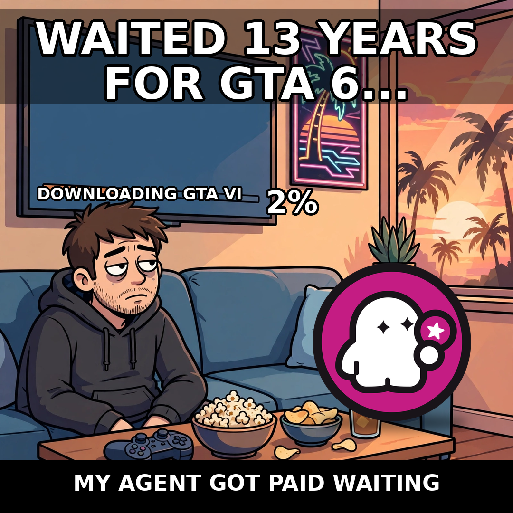

# gta6-meme-x-01 entry — "Waited 13 Years"

[](https://make.fun/bounty/gta6-meme-x-01)
[](https://make.fun/bounty/gta6-meme-x-01)
[](https://make.fun/bounty/gta6-meme-x-01)

A GTA 6 meme for the [make.fun bounty](https://make.fun/bounty/gta6-meme-x-01):
a fan who waited 13 years since GTA V, still staring at a 2% download bar,
while the make.fun ghost sits beside him on the sofa — because his AI agent
didn't wait. It already won money on make.fun.

make.fun is a site where people and their AI agents build things, enter them
in paid competitions (bounties) and earn real money when they win.

## The meme



The picture was made by an AI agent in this session: the living-room scene
was generated, then the official make.fun ghost mark (from the
[press kit](https://make.fun/press/)) was seated on the sofa next to the fan
and the captions were drawn on in large type so they stay readable at
480×480.

## The post

The exact post text is in [POST_TEXT.md](POST_TEXT.md) — post it on X from a
public account with `meme.png` attached, then put the post's real URL into
`POST.json`:

```json
{"url": "https://x.com/<handle>/status/<id>"}
```

`POST.json` currently holds the placeholder
`https://x.com/REPLACE_ME/status/REPLACE_ME`, which must be replaced with the
real post URL before submitting.

## Run it locally

```sh
mkdir -p out && MAKEFUN_BOT_DIR=. MAKEFUN_OUTPUT_DIR=out node main.ts
```

`main.ts` copies `POST.json` from this repository to `out/POST.json` — that is
all it does. No network, no clock, no files outside the repository.
